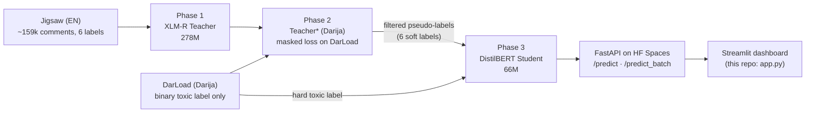

# AMANE: Toxic Comment Detection in Moroccan Darija

Cross-lingual knowledge distillation: an English multi-label toxicity teacher (XLM-R) is adapted to Moroccan Darija, then distilled into a ~4× smaller, ~4× faster DistilBERT student.

> 🇫🇷 **Résumé** : AMANE détecte les commentaires toxiques en darija marocaine. Un Teacher XLM-R entraîné sur Jigsaw (anglais, 6 labels) est adapté au darija (DarLoad) avec une loss masquée, puis distillé dans un Student DistilBERT ~4× plus petit et plus rapide. Projet d'équipe EMSI (mai 2026), servi par une API FastAPI publique sur Hugging Face Spaces.

## Demo

- **Public inference API (live):** https://bhm03-amane-api.hf.space (FastAPI + Docker on Hugging Face Spaces). Interactive docs at [`/docs`](https://bhm03-amane-api.hf.space/docs).
- **Streamlit dashboard:** `[STREAMLIT_APP_URL]` <!-- TODO: add the confirmed Streamlit Cloud URL, or remove this line -->

<!-- TODO: add screenshot of the "Analyse" page (Darija toxic preset, with per-label probability bars) -->
<!-- TODO: add screenshot of the "Comparaison 4 modèles" page -->
<!-- TODO: add GIF of the "YouTube Analyse" page fetching and scoring comments -->

## The problem

Toxicity datasets and models are overwhelmingly English. Moroccan Darija is written in both Arabic script and Latin "Arabizi" (`3`, `7`, `9` for Arabic sounds), mixes in French and Arabic, and has very little labelled data. The only Darija dataset used here (DarLoad) carries a **single binary `toxic` label**, while the English Jigsaw data has six. The goal is to transfer the English six-label knowledge to Darija without pretending the missing Darija labels are known, and to end with a model small enough to serve cheaply.

## Approach



1. **Teacher (EN).** `xlm-roberta-base` with mean pooling and a 6-way sigmoid head, trained on Jigsaw with `BCEWithLogitsLoss` and per-label `pos_weight` ([`models/teacher/pos_weights.json`](models/teacher/pos_weights.json)) to handle the heavy class imbalance (e.g. `threat` ≈ 333).
2. **Teacher\* (Darija).** The teacher is fine-tuned on DarLoad with a **masked loss**, a very low learning rate (1e-5) and only 2 epochs, to adapt to Darija without catastrophically forgetting the six English labels.
3. **Pseudo-labeling + distillation.** Teacher\* labels DarLoad with six soft probabilities, and unreliable pseudo-labels are filtered out. `distilbert-base-multilingual-cased` (CLS pooling) is then trained with a hybrid loss: `α ×` (BCE on DarLoad's ground-truth `toxic` label) `+ (1 − α) ×` (distillation term on Teacher\*'s six soft labels). The app lists α = 0.3.

### Key idea: unknown is not negative

DarLoad only says whether a comment is `toxic`. It says nothing about `obscene`, `threat`, `insult`, `severe_toxic` or `identity_hate`. Writing 0 for those five labels would teach the model that every Darija insult is "not an insult". The masked loss computes BCE **only on the `toxic` column**, so the five unknown labels get **zero gradient** and keep what the teacher learned from English.

> The training notebooks (Kaggle) are not in this repository. The pipeline, masked-loss and hybrid-loss description shown in the app lives in the *Pipeline & Métriques → Architecture* tab of [`app.py`](app.py).

## Results

| Model | Size | Data / task | F1 |
|---|---|---|---|
| TF-IDF + LogReg (OVR) | — | English Jigsaw, 6-label macro F1 | 0.568 |
| XLM-R teacher | 278M | English Jigsaw, 6-label macro F1 | 0.623 |
| Teacher\* | 278M | adapted to Darija (DarLoad), binary toxic | 0.815 |
| DistilBERT student | 66M | DarLoad, binary toxic | 0.895 |

The student is **~4× smaller** (66M vs 278M parameters) and **~4× faster** (≈240 ms → ≈60 ms per comment on CPU) than the teacher.

**How to read this table**

- The first two rows and the last two rows are **different tasks** (6-label English vs binary Darija), so compare within each pair, not across.
- The three transformer scores are best-epoch **validation** F1, recorded in [`models/teacher/training_history.json`](models/teacher/training_history.json), [`models/teacher_star/training_history_star.json`](models/teacher_star/training_history_star.json) and [`models/student/training_history_student.json`](models/student/training_history_student.json). They are not scores on a separate held-out test set.
- Decision thresholds were tuned on validation: 0.8 per label for the EN teacher (0.79 for `threat`), 0.45 for Teacher\*, 0.6 for the student ([`models/*/threshold*.json`](models/)).

## Inference API

Base URL: **https://bhm03-amane-api.hf.space**

| Method | Path | Body | Returns |
|---|---|---|---|
| `GET` | `/health` | — | load status of each model |
| `POST` | `/predict` | `{"text": "...", "model": "student"}` | probabilities for the 6 labels |
| `POST` | `/predict_batch` | `{"texts": ["...", "..."], "model": "student"}` | one probability dict per text |

`model` is one of `"student"` (default), `"teacher"` or `"benchmark"`. The six labels are `toxic`, `severe_toxic`, `obscene`, `threat`, `insult` and `identity_hate`.

```bash
curl -X POST https://bhm03-amane-api.hf.space/predict \
  -H "Content-Type: application/json" \
  -d '{"text": "labas 3lik khoya? kif nta?", "model": "student"}'
```

The Space can be asleep on first call; retry after a few seconds if it times out. Teacher\* is not served by the public API (only `benchmark`, `teacher` and `student` are loaded), so the dashboard shows it as unavailable.

## Dashboard features (`app.py`)

- **Analyse:** score a single comment with any model the API has loaded, with per-label probabilities and an overall toxicity level.
- **Comparaison 4 modèles:** run the same comment through every available model side by side.
- **Batch CSV:** upload a CSV with a `comment_text` column, score every row, download the annotated CSV.
- **YouTube Analyse:** paste a video URL and **your own** YouTube Data API v3 key (entered in the UI, never stored) to fetch and score its comments.
- **Pipeline & Métriques:** roadmap, training curves from the JSON histories, and the architecture.

## Tech stack

PyTorch · Hugging Face Transformers (XLM-RoBERTa, DistilBERT multilingual) · scikit-learn (TF-IDF + One-vs-Rest LogReg) · FastAPI + Docker on Hugging Face Spaces · Streamlit · Plotly · Pandas · YouTube Data API v3

## Run locally

The dashboard only needs the public API; no model weights are downloaded.

```bash
git clone https://github.com/Adil-Bouhoum/Aman-Toxicity-Detector.git
cd Aman-Toxicity-Detector
python -m venv .venv
source .venv/bin/activate        # Windows: .venv\Scripts\activate
pip install -r requirements.txt
cp .streamlit/secrets.toml.example .streamlit/secrets.toml   # Windows: copy .streamlit\secrets.toml.example .streamlit\secrets.toml
streamlit run app.py
```

`app.py` reads `API_URL` from `.streamlit/secrets.toml` and fails to start if that file is missing. Edit the file to point the dashboard at another API, such as `http://localhost:7860`.

To run the models **in-process** (`predictor.py`, `test_teacher.py`), install the extra dependencies. The `.pt` checkpoints are downloaded from the Hugging Face Hub repo [`BHM03/amane-models`](https://huggingface.co/BHM03/amane-models) on first use.

```bash
pip install -r requirements-local.txt
python test_teacher.py
```

## Project structure

```
app.py                     Streamlit dashboard (calls the public API)
predictor.py               Model classes + loaders (local files, else HF Hub download)
utils.py                   Label names, text cleaning, toxicity level
test_teacher.py            Smoke test for the teacher and benchmark
models/
  ovr_balanced.joblib      TF-IDF benchmark classifier
  tfidf_vectorizer.joblib  TF-IDF vectorizer
  teacher/                 EN teacher config, thresholds, pos_weights, history, tokenizer
  teacher_star/            Teacher* threshold + history (weights not published)
  student/                 Student threshold + history
.streamlit/secrets.toml.example  API_URL config template
requirements.txt           Dashboard dependencies
requirements-local.txt     Extra dependencies for in-process inference
```

The FastAPI service code (`app.py`, `Dockerfile`) lives in the [`BHM03/amane-api`](https://huggingface.co/spaces/BHM03/amane-api) Space, not in this repository.

## Limitations & next steps

- **Research prototype.** It is not meant for production moderation.
- **Only `toxic` is supervised in Darija.** The other five Darija labels come from English transfer and are poorly calibrated, so treat them as hints.
- **Hard cases.** Sarcasm, code-switching (Darija/French/Arabic) and Arabizi spelling variation (`3`/`a`, `7`/`h`, many spellings of one word) remain difficult.
- **Noisy pseudo-labels.** The student learns from Teacher\*'s predictions, so the teacher's errors are inherited.
- **Validation, not test.** The reported F1 scores are validation scores. A held-out Darija test set would make them stronger.
- **Next steps:** publish the training notebooks and the API code in this repo, serve Teacher\*, and evaluate on a held-out test split.

## Team & role

EMSI 4th-year AI & Data Science project (May 2026), team of 4, supervised by **Dr. Driss Essabar**.

| Member | Role |
|---|---|
| **Adil Bouhoum** | Data & benchmark; public deployment (FastAPI + Docker on Hugging Face Spaces) |
| Ilias Ait Barrehil | Pseudo-labeling & DistilBERT student |
| Achraf Abderrazik | Deployment & Streamlit dashboard |
| Marouane El Mahlali | Data & benchmark |

## Author

**Adil Bouhoum**: [Portfolio]([PORTFOLIO_URL]) · [LinkedIn]([LINKEDIN_URL]) · [GitHub](https://github.com/Adil-Bouhoum)
